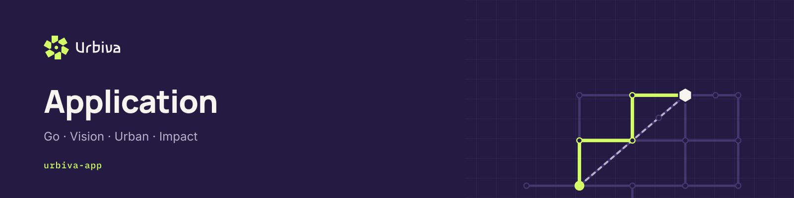
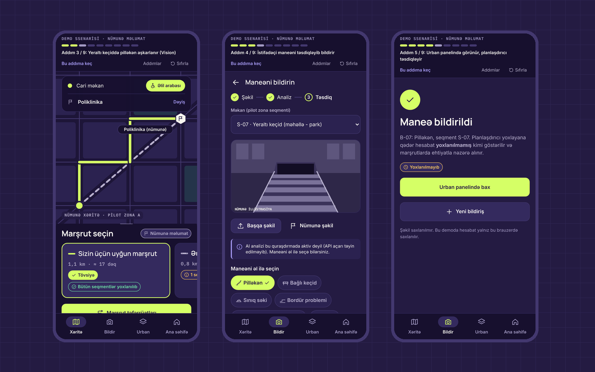
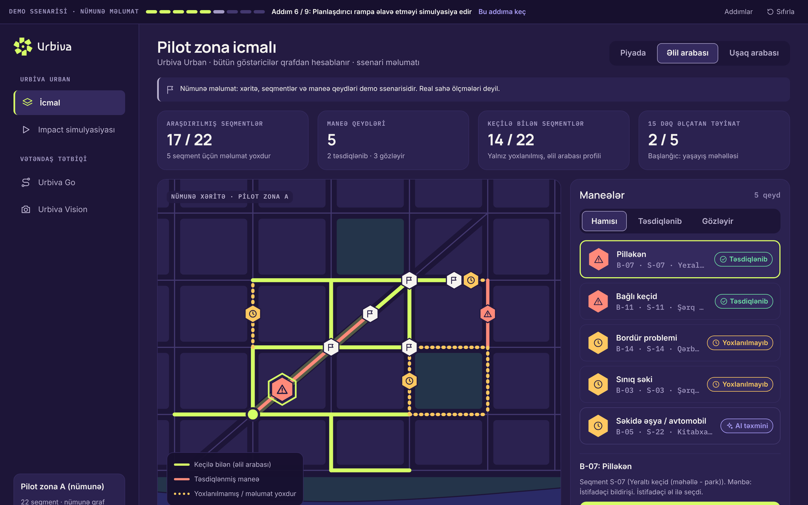
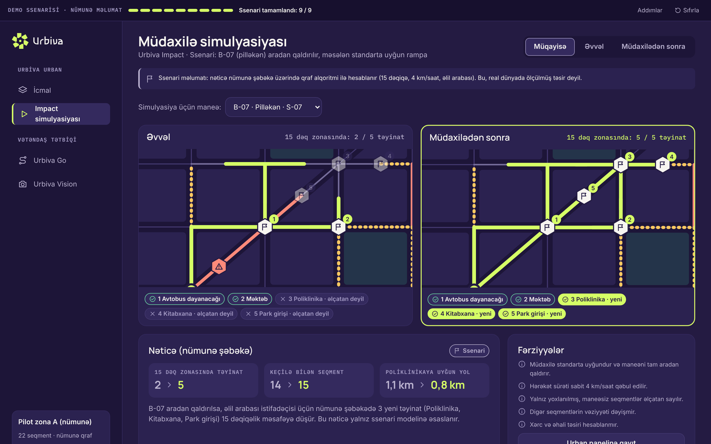
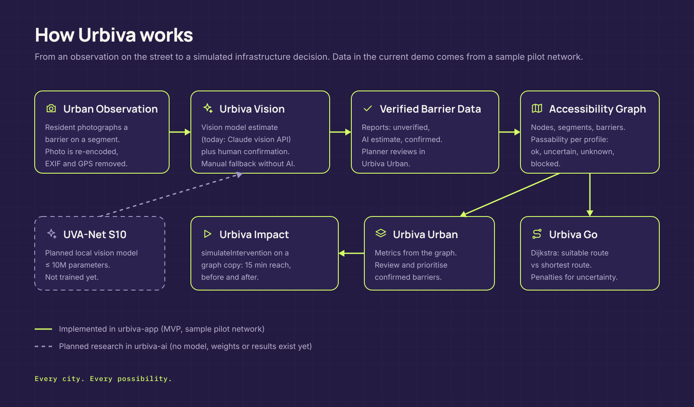

<picture>
  <source media="(prefers-color-scheme: light)" srcset="docs/images/header-urbiva-app-light.png">
  
</picture>

# urbiva-app

**Human-centered urban intelligence platform for accessible navigation, AI-assisted reporting, and infrastructure simulation.**

Urbiva helps residents find walking routes that suit their mobility, lets anyone report a street barrier from a photo, and gives city planners a graph-based way to see which barrier to remove first. This repository holds the hackathon MVP: a Next.js App Router application with four modules and a guided nine-step demonstration.

> **Sample data.** "Pilot zona A" is an invented, simplified street network (17 nodes, 22 segments). It is not a survey of real Baku streets. Every segment, barrier and result in the app is scenario data, and every screen labels it as such.

<p align="center">
  
</p>

## Modules

| Module | Route | For | What it does today |
| --- | --- | --- | --- |
| **Urbiva Go** | `/go` | Residents, mobile | Mobility profile, destination, suitable vs shortest route from the graph, segment-level trust, link to report a barrier |
| **Urbiva Vision** | `/vision` | Residents, mobile | Photo or sample illustration, AI estimate (Claude vision) with human correction and confirmation, manual fallback without AI |
| **Urbiva Urban** | `/urban` | Planners, desktop | Metrics computed from the graph, segment-state map, barrier list with filters, review (confirm or reject), start a simulation |
| **Urbiva Impact** | `/impact` | Planners, desktop | Before and after 15-minute reachability, deltas, generated explanation, assumptions |

<p align="center">
  
</p>

<p align="center">
  
</p>

## The nine-step demonstration

A demo bar at the top of every screen tracks progress from app state; "Sıfırla" resets it.

1. Choose the wheelchair profile and the destination Poliklinika (`/go`).
2. Urbiva computes the suitable route: 1,1 km on surveyed streets. The shortest route (0,8 km) uses the unsurveyed underpass S-07.
3. "Bu seqmentdə maneə bildir" opens Vision; the photo is analysed (AI estimate, or manual choice without a key).
4. The person confirms the category; report B-07 is stored as unverified.
5. Urban shows B-07; the planner clicks **Təsdiqlə**.
6. The planner clicks **Müdaxiləni simulyasiya et**.
7. The graph is recalculated on a copy with the barrier removed.
8. 15-minute reachability goes from 2 of 5 to 5 of 5 destinations (computed, not hardcoded).
9. Impact shows both maps, the deltas and a generated explanation.

## How it works

<picture>
  <source media="(prefers-color-scheme: light)" srcset="docs/images/urbiva-architecture-light.png">
  
</picture>

### Implemented vs sample vs planned

| Area | Status |
| --- | --- |
| Routing engine (`src/lib/engine`) | **Implemented.** Dijkstra over nodes and segments with barrier and verification states, profile rules, suitable vs shortest routes, 15-minute reachability, intervention simulation, metrics. Runs in the browser. |
| Reports, planner review, simulation state | **Implemented, local only.** No database: state lives in the browser (`localStorage`, key `urbiva-demo-v1`). Photos are never stored. |
| AI classification (`/api/vision`) | **Implemented integration** with Claude vision (Anthropic Messages API). Needs `ANTHROPIC_API_KEY`. Without a key the app says AI is not configured and offers manual classification; it never invents a result. Results stay "AI təxmini" until a person confirms. |
| Pilot network, barriers, distances | **Sample data** (`src/data/pilot-network.ts`). 1 map unit = 2.2 m; 4.8 km/h pedestrian, 4 km/h wheelchair and stroller. |
| Own vision model (UVA-Net S10) | **Planned research** in `urbiva-ai`. Not trained, no weights, no results. |

### Routing rules

- Passability per segment and profile: `blocked` (confirmed barrier blocks the profile), `uncertain` (unverified or AI-only barrier), `unknown` (never surveyed), `ok`.
- **Suitable route:** excludes `blocked`; cost x3 for `uncertain` and x2 for `unknown`.
- **Shortest route:** geometric shortest path for a pedestrian, then evaluated for the chosen profile.
- **Planner reachability:** conservative; only `ok` segments count.
- **Intervention:** removes the barrier and marks the segment surveyed, on a copy of the network.

## Tech stack

Next.js 16 (App Router) · React 19 · TypeScript 5.9 · Tailwind CSS 4 · `node:test` via `tsx` · Playwright (local harness only).

Fonts: Manrope and IBM Plex Mono are bundled in `src/app/fonts/` under the SIL Open Font License (licence files included) and verified by SHA-256 in `scripts/fetch-fonts.mjs`; Inter comes from `next/font/google`. The logo is drawn from the approved master vectors, never typeset.

## Getting started

Requirements: Node.js 20.9 or newer (CI uses Node 22) and npm.

```bash
npm install
cp .env.example .env.local     # optional: add ANTHROPIC_API_KEY for live AI
npm run dev                     # http://localhost:3000
```

All scripts, as defined in `package.json`:

| Command | What it runs |
| --- | --- |
| `npm run dev` | `next dev` |
| `npm run build` | `next build` (the `prebuild` hook runs `node scripts/fetch-fonts.mjs`) |
| `npm start` | `next start` |
| `npm test` | `tsx --test tests/*.test.ts` (engine and vision API) |
| `npm run typecheck` | `tsc --noEmit` |
| `npm run verify` | typecheck, tests and build |

### Environment

| Variable | Where | Purpose |
| --- | --- | --- |
| `ANTHROPIC_API_KEY` | Server only | Enables live AI in Vision. Never prefix with `NEXT_PUBLIC_`. |
| `URBIVA_VISION_MODEL` | Server only | Optional model id, default `claude-sonnet-5-5`. |

`.env`, `.env.local` and other secrets are ignored by Git. Never commit keys.

## Project structure

```
src/app/              Next.js routes (thin) and the /api/vision route handler
src/modules/          Screens: home, go, vision, urban, impact
src/components/       Logo (master vectors), icons, pilot map, UI primitives, shells, demo guide
src/lib/engine/       Graph types, routing, reachability, metrics, scenario state
src/lib/vision/       Categories, server analysis, request handler, browser image preparation
src/data/             Sample pilot network and assumptions
tests/                Unit tests (engine, vision API)
scripts/              Font fetch and verification used by the build
sandbox-preview/      Optional offline esbuild harness and Playwright checks used during development
docs/images/          README images (real screenshots from the app)
```

## Privacy and safety

- The API key is read only on the server and never exposed to the browser.
- The browser re-encodes photos to JPEG (max 1280 px), which strips EXIF and GPS metadata before upload.
- The server accepts JPEG, PNG or WebP up to 5 MB, checks magic bytes, rate-limits per client, does not log or store images, and maps provider errors to safe messages.

## Status

| | |
| --- | --- |
| Stage | Hackathon MVP, version 0.3.0 |
| Design | Figma design system v1.0, design freeze (Dark and Light, responsive, nine-step prototype) |
| Quality checks | 12 unit tests; responsive QA at 375, 390, 430, 768, 1024 and 1440 px; end-to-end demo checks in `sandbox-preview/` |
| Deployment | Not deployed. Deployment is paused until the next phase. |

## Roadmap

- Replace sample data with licensed OpenStreetMap data and field surveys for one real pilot zone.
- Persist reports and reviews on a server with access control.
- Integrate the planned on-device or self-hosted vision model from `urbiva-ai`, keeping human confirmation.
- Bring the Light theme from the design system into the app.
- Prioritisation view for planners (designed, not implemented).

## Contributing

Read [CONTRIBUTING.md](CONTRIBUTING.md). Branches: `feat/*`, `fix/*`, `docs/*`, `chore/*`, merged into `main` through pull requests with passing CI. Report security issues as described in [SECURITY.md](SECURITY.md).

## Urbiva repositories

| Repository | Purpose |
| --- | --- |
| **urbiva-app** | Application: Go, Vision, Urban and Impact |
| [`urbiva-ai`](https://github.com/urbiva/urbiva-ai) | Research setup for UVA-Net S10, a planned local vision model |
| [`urbiva-brand`](https://github.com/urbiva/urbiva-brand) | Logo package, tokens, guidelines and GitHub brand kit |
| [`urbiva-docs`](https://github.com/urbiva/urbiva-docs) | Product specifications, architecture, decisions and roadmap |

## License

Private repository. All rights reserved by Urbiva. No license is granted for use, copying or distribution. See [LICENSE](LICENSE).
